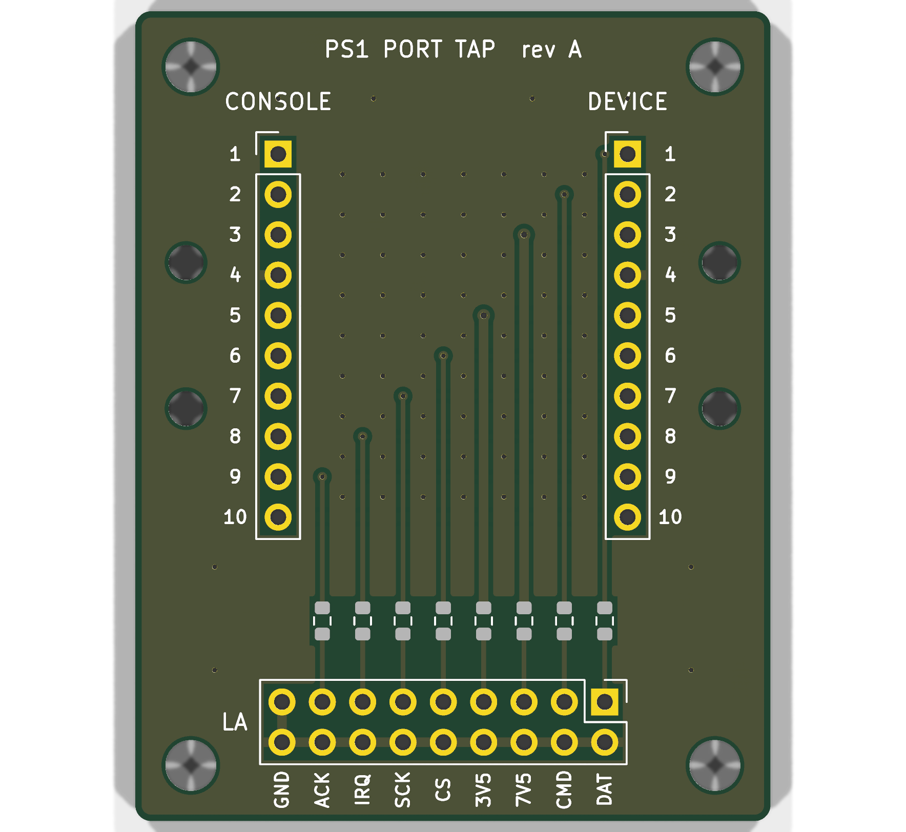

# ps1-port-tap

A pass-through for one PlayStation controller or memory card port, with every line
broken out to a 0.1" header for a logic analyser. Cut a controller extension cable in
half, solder the console half to J1 and the device half to J2, and clip the analyser
onto J3.

## Why it is wired to a cut cable

The PS1 port connector is proprietary, and I could not find a published drawing of it
I would trust. The best public source is a forum post giving a 4 mm pitch, but its
author traced the positions from a scaled photo. So this revision has no connector on
the board: J1 and J2 are 1x10 rows at
2.54 mm with 1.0 mm holes, big enough for the cable's conductors. The M2 holes beside
each row are for zip ties that hold the cable jacket. A board-mounted socket can come
in a later revision, once someone has put calipers on a real one.

## Pinout

From psx-spx, `docs/ps1/pinouts/controller-ports-and-memory-card-ports.md`. Pins 1-9
are the port pins. Pin 10 carries the cable shield straight through and is not tapped.
Memory card slots have no IRQ (pin 8) and no shield.

| Pin | Signal | | Pin | Signal |
|---|---|---|---|---|
| 1 | DAT, data from device | | 6 | /CS, port select |
| 2 | CMD, data to device | | 7 | SCK, clock |
| 3 | +7.5V, rumble supply | | 8 | /IRQ, lightgun |
| 4 | GND | | 9 | /ACK, acknowledge |
| 5 | +3.5V, logic supply | | 10 | shield |

The full table is also printed on the back silkscreen, so the cable can be wired from
the board alone.

J3 is a 2x9 header. Odd pins carry the taps (DAT, CMD, 7V5, 3V5, CS, SCK, IRQ, ACK)
and every even pin is GND, so each probe gets its own ground. The signal taps go through
100R, which keeps the analyser's lead capacitance off the bus; fit 0R if you want a
transparent tap. The two supply taps go through 10k, so a probe clipped onto a rail
cannot short it.

## Layout

Two layers, 40 x 51 mm, routed by script and every run straight. Port line n crosses
B.Cu from J1 pin n to J2 pin n. A tapped line drops through a via at its J3 column and
runs straight down F.Cu to its resistor, and on to its J3 pin. Both layers are poured
with GND, with stitching vias between the through-lines, so the copper there stays as
stitched guard ground. The pour stops at a straight edge around each pad row, because
between two header pads it can only form slivers; the GND pins inside those strips reach
the pour through traces.

`tools/check_geometry.py` checks what DRC does not. It flags any bend sharper than
45 degrees, any segment shorter than its width, any trace narrower than its net class,
any dangling end and any overlapping segment. `tools/crops.sh` renders every pad row
and the resistor row at about 4x, in `renders/crops/`.

## Files

- `ps1-port-tap.kicad_sch`, `.kicad_pcb`, `.kicad_pro`: KiCad 10 project
- `schematic.pdf`, `renders/`: every copper and silk layer, plus 3D views
- `fab/ps1-port-tap-gerbers.zip`, `fab/ps1-port-tap-bom.csv`, `fab/ps1-port-tap-cpl.csv`:
  ready for JLCPCB, with the resistors assembled and the headers hand-fitted. On the
  JLC preview, check that the resistors sit square on their pads. LCSC lists C25804 (10k)
  as out of stock right now; any 0603 10k works.

## Rebuilding

Everything is generated from the scripts in `tools/`. `tools/build.sh` runs the whole
pipeline: schematic, ERC, placement and routing through the pcbnew Python API, pours,
DRC with schematic parity, the geometry check, renders, crops and fab outputs. It stops
on any ERC, DRC or geometry finding. Requires KiCad 10 (`kicad-cli` and the `pcbnew`
Python module), `rsvg-convert` and ImageMagick.

Not yet built or tested on hardware.
